# SysPulse 架构

本文描述当前源码的运行方式。开发、打包和常用命令见 [README](../README.md)；清理模块的外部方案对照见[历史研究](cleanup-research-2026-11-04.md)。

## 总览



系统由 Tauri 主进程、两个 WebView2 窗口和 .NET 硬件 helper 子进程组成。原生悬停卡在 Rust 主进程的 UI 线程绘制，没有额外 WebView。Rust 负责采集、文件操作、持久化与进程管理；前端负责交互、状态呈现和查询调度。

图中连线表示主要通信和数据依赖。流量数据库由 Writer 路径读取，硬件 helper 通过标准输入输出通信。

## 入口与职责

| 层 | 源码入口 | 职责 |
| --- | --- | --- |
| 应用生命周期 | [main.rs](../src-tauri/src/main.rs)、[lib.rs](../src-tauri/src/lib.rs)、[app.rs](../src-tauri/src/app.rs) | 注册插件与 IPC，初始化配置、采集和服务，处理单实例、窗口和退出 |
| 主窗口 | [main.tsx](../src/main.tsx)、[App.tsx](../src/App.tsx)、[路由清单](../src/routes/registry.tsx) | React 页面、Ant Design、应用级 Zustand 状态；页面按需加载 |
| 悬浮窗 | [overlay.ts](../overlay/overlay.ts)、[overlay.css](../overlay/overlay.css) | 独立入口，接收快照，排列监控项，按实际内容调整窗口尺寸，上报悬停区域 |
| IPC 契约 | [命令清单](../src-tauri/src/ipc/commands/mod.rs)、[bindings.ts](../src/bindings.ts)、[ipc.ts](../src/ipc.ts) | Specta 生成类型与命令；生产和测试使用同一 Rust 命令清单 |
| 基础采集 | [sampler.rs](../src-tauri/src/sampler.rs)、[monitor/](../src-tauri/src/monitor) | CPU、内存、网卡计数和速率；按接口跟踪流量增量 |
| 硬件与风扇 | [hw/](../src-tauri/src/hw)、[hw-helper/](../hw-helper) | helper 就绪与重启、快照采样、传感器年龄、PWM / 曲线和保护 |
| 持久化 | [config/](../src-tauri/src/config)、[storage/](../src-tauri/src/storage) | TOML 配置、变更广播、SQLite WAL、流量 Writer 与保留期 |
| 清理服务 | [cleanup_cmd.rs](../src-tauri/src/ipc/commands/cleanup_cmd.rs)、[cleanup/](../src-tauri/src/ipc/commands/cleanup) | 发现目标、生成扫描计划、复核与删除、取消和结构化结果 |
| AI 服务 | [ai/mod.rs](../src-tauri/src/ai/mod.rs)、[ai/backend/](../src-tauri/src/ai/backend) | 客户端适配、MCP、OAuth 代理与刷新、多来源会话存储 |
| Windows 集成 | [windows_api/](../src-tauri/src/windows_api)、[tray.rs](../src-tauri/src/tray.rs) | 任务栏定位与层级、自绘悬停卡、托盘；计划任务自启由 [autostart_cmd.rs](../src-tauri/src/ipc/commands/autostart_cmd.rs) 管理 |

## 启动、状态与退出

`main.rs → lib::run → app::setup` 初始化 AI 服务、配置、数据库和 Writer，随后启动基础采集、硬件客户端和风扇看门狗。硬件状态与快照订阅先建立，再启动 helper；采样等待 `ready`，不会把正常初始化阶段当成采集故障。`AppState` 注册后才应用初始窗口状态。

Rust 保存最近一次基础和硬件快照，WebView 首次加载时通过命令读取，之后消费事件。主窗口的 `liveStore`、`hwStore`、`configStore`、`cleanupStore`、`historyStore`、`mcpStore` 和 `autostartStore` 保存各自状态；切换页面不重新创建后端任务。历史页的每秒刷新只在该页面挂载且可见时执行，MCP 扫描计时器属于主窗口应用生命周期。

关闭主窗口会隐藏到托盘；重复启动恢复已有窗口。显式退出取消风扇看门狗，并在 2 秒总期限内并行停止采样、刷新流量缓冲、恢复风扇控制并关闭 helper，随后退出运行时。恢复和刷新失败、关闭超时会留下诊断日志。窗口意外丢失不等同于用户主动退出。

## 基础采样与流量历史

基础采集使用独立 Tokio 任务，固定间隔为 500～5000 ms；自适应模式根据 CPU、网络及其变化量，将间隔调整到 500～2000 ms。`monitor/` 读取系统和网卡计数，`sampler.rs` 广播快照并向 Writer 发送按日期、接口分组的增量。

流量 Writer 是单一消息消费者。增量先进入内存缓冲，定时批量事务落盘；查询与落盘在同一路径中串行处理，将数据库记录和未落盘增量合并，避免查询时漏算或重复累计。事务失败保留缓冲供后续重试。SQLite 使用 WAL、连接池与版本迁移。

历史查询支持按日/月聚合及可选网卡过滤。起止日期均为空表示全部现存记录；只指定一端时仅应用该边界。前端按月查询会将已填写的端点转换到月初/月末。实时累计统计和 CSV 导出沿用最近一次成功查询的范围。历史保留期独立于查询条件，空范围不会恢复已清理的数据。

## 硬件 helper 与风扇保护

Rust `HwClient` 通过 stdio JSON Lines 发送带 ID 的请求，处理响应、`ready` / 故障事件和 stderr 日志。监督任务负责启动、超时和有界重启；硬件采样在请求完成后等待下一轮，失败逐步退避到最多 8 秒，避免慢设备触发追赶式请求。

.NET helper 使用 LibreHardwareMonitor 0.9.4。普通传感器与磁盘分别在线程中采集，等待间隔分别为 1 秒和 3 秒；快照请求读取已发布缓存，慢磁盘不会阻塞整个协议。WMI 元数据另行加载。快照分别携带普通传感器和磁盘年龄，Rust 再计入缓存停留时间。

硬件页面与悬浮窗超过 5 秒标记延迟，超过 30 秒显示未知；真实零值仍保留。原生悬停卡按后端快照新鲜度过滤硬件内容。风扇控制使用 5 秒新鲜度约束。Rust 管理手动 PWM、CPU 温控曲线及 2 秒看门狗；温度缺失、过期、达到 90°C 或连续写入失败触发保护。helper 只执行确认关联的控制通道，不按相同索引猜测风扇与 PWM 的对应关系。

## 任务栏与原生悬停卡

悬浮窗保持独立顶层窗口，通过 Win32 定位与层级事件跟随任务栏，定时检查作为后备恢复；不把窗口挂到 Explorer 的父子窗口树。显示项排序通过共享规则保持网速、硬盘读写成对，数值宽度按内容测量。

前端上报实际读数区域。Rust 悬停检测从共享快照构建文案，并在 UI 线程调用 [custom_tooltip.rs](../src-tauri/src/windows_api/custom_tooltip.rs)。[drawing.rs](../src-tauri/src/windows_api/custom_tooltip/drawing.rs) 用 DirectWrite 测量与绘制中文和数值，通过 Direct2D 灰度抗锯齿避免 ClearType 彩边；文字与几何使用同一 DPI 的物理像素坐标。

圆角以预乘 Alpha 帧交给 `UpdateLayeredWindow` 合成，窗口不激活、鼠标穿透。状态灯的 2.4 秒呼吸效果只修改缓存图像中的灯区，文字不随动画重绘；隐藏或销毁时释放图像和计时器，并遵循 Windows 动画设置。

## 清理与 AI 服务边界

清理分为发现、扫描计划、用户选择和执行。后端缓存扫描 ID 及逐文件计划，执行时复核文件身份、大小、时间、父链、重解析点和占用状态，只处理扫描时记录且仍符合条件的文件。变化、缺失、占用、失败和取消分别统计；前端切页不会中断任务，结果保留到下一次主动扫描。

并发由共享队列和预算限制，类别、项目发现和目录统计各自有上限；不要把任务数量当成线程数量。规则和删除实现分别见 `tool_caches.rs` / `system_caches.rs` 与 `plan.rs` / `remove.rs`。历史研究中的建议是当时的设计输入，不能当成当前实现说明。

AI 模块使用独立 `AiState` 和数据目录。MCP 配置适配 Kiro、Codex、Claude CLI；主窗口启动时及每两小时静默刷新，手动修改后同步相关客户端。OAuth 代理、凭据持久化和 Token 刷新在 Rust 后端。会话来源包括 Kiro、Claude、Antigravity、Gemini，支持的读取、导出和删除能力按来源区分；Codex 仅保留 MCP 管理，没有会话扫描入口。

## 主要通知

| 事件 | 用途 |
| --- | --- |
| `stats:update` | CPU、内存和网络快照，驱动概览及悬浮窗 |
| `hw:update`、`hw:helper-status` | 硬件数据、helper 生命周期和显示新鲜度 |
| `config:changed`、`overlay:config-changed` | 配置状态及悬浮窗显示项更新 |
| `fan-control:changed` | 风扇控制状态 |
| `cleanup:scan-progress`、`cleanup:progress` | 扫描与清理任务进度 |

历史查询与导出使用请求/响应接口，历史页可见时定时刷新。持久化配置和业务校验由 Rust 管理，前端保存界面状态与最近一次查询结果。

## 架构图维护

[architecture.mmd](architecture.mmd) 是图的源文件，[mermaid-config.json](mermaid-config.json) 固定样式，[architecture.svg](architecture.svg) 是 README 引用的渲染产物。修改图时同步源文件和 SVG；SVG 保留矢量文字，放大不失真，也不依赖 Markdown 查看器支持 Mermaid。

在仓库根目录使用 Mermaid CLI 重新生成：

```powershell
npx.cmd --yes --package @mermaid-js/mermaid-cli@11.12.0 mmdc -i docs/architecture.mmd -o docs/architecture.svg -c docs/mermaid-config.json -b white
```

已有 Chrome 的环境可设置 `PUPPETEER_EXECUTABLE_PATH`，配合 `PUPPETEER_SKIP_DOWNLOAD=true` 复用浏览器。图形工具仅用于文档维护，不加入应用运行依赖。
